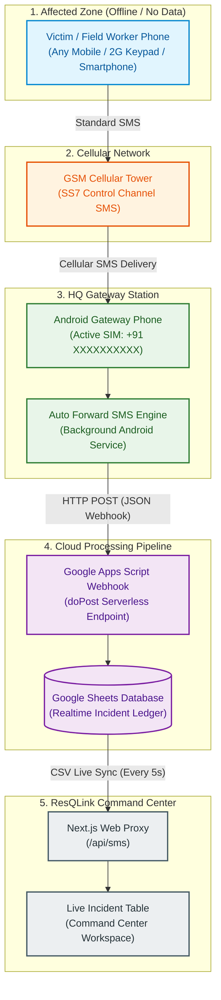

# 📱 ResQLink — Off-Grid SMS Gateway Setup & Deployment Guide

> **Architecture Overview**: Enables real-time emergency disaster reporting from any mobile phone (even basic 2G feature phones without internet access) directly into the ResQLink Command Dashboard using GSM control-channel SMS, an Android forwarder bridge, and Google Sheets.

---

## 🗺️ 1. End-to-End Architecture



---

## 🛠️ 2. Hardware & Software Requirements

| Component | Required Item / Tool | Description & Purpose |
| :--- | :--- | :--- |
| **Sender Device** | Any Mobile Phone | Any smartphone or basic keypad phone able to send standard SMS. |
| **HQ Gateway Phone** | Android Smartphone (Android 8.0+) | Placed at HQ / base camp with an active SIM card and Wi-Fi/4G internet. |
| **Forwarding App** | *Auto forward SMS to PC / Phone* (by Enstone) | Free Android background service available on Google Play Store. |
| **Webhook Endpoint** | Google Apps Script (`doPost`) | Serverless script that intercepts HTTP payloads and parses message parameters. |
| **Database** | Google Sheets | Live spreadsheet holding incident logs and disaster metrics. |
| **Dashboard** | ResQLink Web Command Center | Next.js admin portal continuously polling and rendering incoming incidents. |

---

## 🚀 3. Step-by-Step Deployment Instructions

### Step 1: Set Up the Google Sheet Database

1. Open [Google Sheets](https://sheets.new) and create a new blank spreadsheet.
2. Name the spreadsheet: **`ResQLink SMS`**.
3. In **Sheet1**, set the headers in **Row 1** across columns **A to E**:

| Column A | Column B | Column C | Column D | Column E |
| :---: | :---: | :---: | :---: | :---: |
| **Timestamp** | **From** | **Latitude** | **Longitude** | **Raw Message** |

> [!TIP]
> If your dashboard is configured to use the Category-Quantity schema, use:  
> `Category` | `Quantity` | `Location` | `Notes`

---

### Step 2: Deploy the Google Apps Script Webhook

1. In your newly created Google Sheet, navigate to **Extensions** > **Apps Script** in the top menu.
2. Delete any existing code in `Code.gs` and paste the following production script:

```javascript
function doPost(e) {
  try {
    // 1. Select the first sheet in the spreadsheet
    var sheet = SpreadsheetApp.getActiveSpreadsheet().getSheets()[0];
    var rawText = "";
    var fromNumber = "Unknown";

    // 2. Parse incoming JSON or Form body
    if (e.postData && e.postData.contents) {
      try {
        var parsed = JSON.parse(e.postData.contents);
        rawText = parsed.text || parsed.message || parsed.body || parsed.sms || parsed.content || parsed.data || e.postData.contents;
        fromNumber = parsed.from || parsed.sender || parsed.phone || parsed.phoneNumber || parsed.address || "Unknown";
      } catch (err) {
        // Fallback for raw text payloads
        rawText = e.postData.contents;
      }
    } 
    
    // Fallback for URL-encoded parameter payloads
    if (!rawText && e.parameter) {
      rawText = e.parameter.text || e.parameter.message || e.parameter.body || e.parameter.sms || JSON.stringify(e.parameter);
      fromNumber = e.parameter.from || e.parameter.sender || e.parameter.phone || "Unknown";
    }

    if (!rawText) rawText = "Empty SMS payload received";

    var timestamp = new Date().toISOString();
    var latitude = "12.5118";  // Default fallback base latitude
    var longitude = "76.8851"; // Default fallback base longitude

    // 3. Fast-Path Regex Parser for Structured Syntax: ResQLink#SOS#LAT,LNG#MESSAGE
    if (rawText.indexOf("ResQLink#SOS#") !== -1) {
      var parts = rawText.split('#');
      if (parts.length >= 3 && parts[2].indexOf(',') !== -1) {
        var coords = parts[2].split(',');
        latitude = coords[0].trim();
        longitude = coords[1].trim();
      }
    }

    // 4. Append extracted values to Google Sheet
    sheet.appendRow([
      timestamp,
      fromNumber,
      latitude,
      longitude,
      rawText
    ]);

    // 5. Return success JSON back to forwarder app
    return ContentService.createTextOutput(JSON.stringify({ "status": "success" }))
      .setMimeType(ContentService.MimeType.JSON);

  } catch (error) {
    return ContentService.createTextOutput(JSON.stringify({ "status": "error", "message": error.toString() }))
      .setMimeType(ContentService.MimeType.JSON);
  }
}
```

3. Click the **Save** (disk) icon.
4. Click **Deploy** > **New deployment** (top right).
5. Click the **Gear icon (Select type)** and select **Web app**.
6. Configure the deployment settings:
   - **Description**: `ResQLink Production SMS Gateway`
   - **Execute as**: `Me (<your-email>)`
   - **Who has access**: **`Anyone`** *(CRITICAL: This allows the Android phone to send webhooks without a Google login prompt).*
7. Click **Deploy**, approve the authorization permissions when prompted, and **copy the Web App URL** (e.g., `https://script.google.com/macros/s/AKfycb.../exec`).

---

### Step 3: Configure the Android Gateway Phone

1. On the designated HQ Android phone, open the **Google Play Store**.
2. Install **Auto forward SMS to PC / Phone** (by Enstone).
3. Open the app and grant all permissions (**SMS**, **Phone Calls**, **Notifications**).
4. **Disable Battery Optimization** *(Vital for continuous background operation)*:
   - Go to Android **Settings** > **Apps** > **Auto Forward SMS** > **Battery**.
   - Select **Unrestricted** / **No restrictions** (prevents Android OS from killing the service in standby).
5. In the app, tap **Add Rule** (`+` button):
   - **Filter**: `Basic Filter`
   - **Trigger**: Check `Incoming SMS`
   - **Forwarding Target**: Select `URL / Web Server / Webhook`
   - **HTTP Method**: `POST`
   - **URL / Webhook Address**: Paste your **Google Apps Script Web App URL** from Step 2.
   - **Number of Retries**: Set to `0` or `1` (avoids duplicate row insertions during slow cellular data handoffs).
6. Save and switch the rule toggle to **ON / Active**.

---

### Step 4: Link the Sheet to ResQLink Web Dashboard

1. In your Google Sheet, click **Share** (top right) and set access to: **"Anyone with the link can view"**.
2. Copy the spreadsheet ID from the URL:
   `https://docs.google.com/spreadsheets/d/`**`<YOUR_SPREADSHEET_ID>`**`/edit`
3. Open [web/src/app/api/sms/route.js](file:///Users/bharathkumara/Desktop/selling/web/src/app/api/sms/route.js) in this project and paste your Spreadsheet ID into line 3:
   ```javascript
   const response = await fetch('https://docs.google.com/spreadsheets/d/<YOUR_SPREADSHEET_ID>/export?format=csv', {
     signal: AbortSignal.timeout(4000),
     next: { revalidate: 5 } // Cached for 5 seconds
   });
   ```
4. Start or restart the web dashboard (`npm run dev` in `web/`). The **"Live SMS Requests (Google Sheets Sync)"** panel will now automatically fetch and display new SMS incidents every 5 seconds.

---

## 💬 4. Supported SMS Formats

Victims or rescue personnel can send messages in either of two modes:

### Mode A: Structured GPS Format (Automated / Smartphone)
Include coordinates directly in the SMS body using `#` delimiters:
```text
ResQLink#SOS#12.5118,76.8851#Water rising near hospital, 4 people trapped
```
- **Result**: The script automatically parses `12.5118` as Latitude, `76.8851` as Longitude, and places the message in the Raw Message column.

### Mode B: Natural Language / Plain Text (Feature Phone / 2G)
Send any normal SMS message without formatting:
```text
Bridge collapsed near Mandya railway gate, need ambulance urgently
```
- **Result**: The script logs the sender's phone number, records the full text, and automatically assigns default HQ coordinates so GIS mapping views do not break.

---

## 🧪 5. Testing & Verification Runbook

1. Take a second phone (not the HQ gateway phone).
2. Send the following text message to the **SIM card phone number** in the Android Gateway:
   ```text
   ResQLink#SOS#12.5118,76.8851#Test SOS Incident Check
   ```
3. **Verify the flow**:
   - Within **1 second**: The Gateway phone receives the SMS and the Auto Forward SMS notification logs `HTTP 200 Success`.
   - Within **2 seconds**: Open the Google Sheet — a new row appears with timestamp, sender number, coordinates, and text.
   - Within **5 seconds**: Open the ResQLink Web Dashboard (`http://localhost:3000`) — the incident appears in the **Live SMS Requests** table.

---

## 🔍 6. Common Issues & Troubleshooting

| Problem | Root Cause | Solution |
| :--- | :--- | :--- |
| **No rows appearing in Google Sheet** | Android killed the background forwarder app. | Go to Android Settings > Apps > Auto Forward SMS > Battery > change to **Unrestricted**. |
| **HTTP 403 Forbidden / Unauthorized error** | Apps Script Web App access scope is restricted. | In Apps Script, click Deploy > Manage deployments > Edit > ensure **Who has access** is set to **`Anyone`**. |
| **Code changes in Apps Script not taking effect** | The deployment is still bound to an older revision. | Deploy > Manage deployments > Edit (pencil icon) > Version: **New version** > click Deploy. |
| **Duplicate rows inserted for a single SMS** | Forwarder retry limit is too high on slow connections. | In the Auto Forward SMS rule, set **Number of Retries** to `0` or `1`. |
| **Web Dashboard shows "Bad Gateway" or CSV error** | Google Sheet is private or spreadsheet ID is invalid. | Ensure Google Sheet Sharing is set to "Anyone with the link can view" and confirm the Spreadsheet ID in `web/src/app/api/sms/route.js`. |
