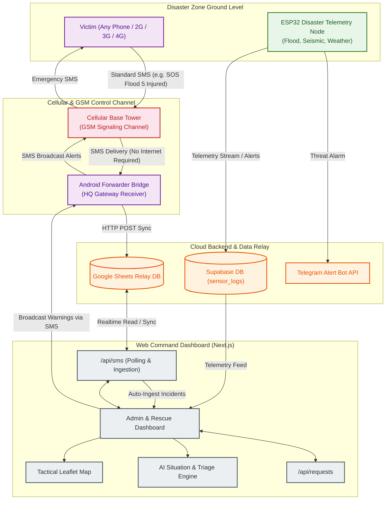

# 📡 ResQLink — Complete System Architecture & Workflow Document

> **Last Updated**: October 2026 | **Version**: 6.0 (Pure GSM SMS Emergency Communication Architecture)
> A unified reference covering every module, technology, protocol, and data pipeline in the ResQLink disaster response platform.

---

## 🗺️ 1. Full-Stack SMS Gateway & Telemetry Architecture

---

## 🛠️ 2. Complete Technology Stack

### Tier 1 — IoT Sensor & Telemetry Nodes
*   **Microcontrollers:** ESP32 DevKit V1 (Main processing, sensor acquisition, deep sleep power management).
*   **Sensor Suites:**
    *   *Flood:* Non-contact HC-SR04 Ultrasonic Sensor + Rain Gauge + Soil Moisture Probe.
    *   *Seismic/Landslide:* MPU6050 (3-Axis Accelerometer/Gyroscope for tremor detection) + Soil Moisture Probe.
    *   *Atmospheric:* DHT11 (Temp/Humidity) + BMP280 (Barometric Pressure & Altitude) + MQ-Series Gas/Smoke sensor.
*   **Power System:** 5W–10W solar panel, TP4056 MPPT Solar Charger, 2000mAh–5000mAh Lithium battery cells with dynamic loop sleep (5s to 30s throttling).

### Tier 2 — Mobile & GSM SMS Reporting Gateway
*   **Universal Compatibility:** Any mobile phone (smartphones, Android, iOS, or basic 2G feature phones with keypad).
*   **Zero Internet Dependency:** Operates entirely over standard GSM voice/SMS control signaling channels that remain active even when mobile data (3G/4G/5G) is cut or congested.
*   **Android Forwarding Bridge:** Automatically captures incoming emergency SMS messages at HQ and forwards structured payloads to Google Sheets via webhooks.

### Tier 3 & 4 — Command & Control Dashboard (Next.js)
*   **Web Framework:** Next.js with React and Canvas-accelerated Leaflet interactive mapping.
*   **Live Incident Ingestion:** `/api/sms` parses incoming SMS alerts, extracts location, severity, and resources requested, and maps them to tactical coordinates.
*   **AI Situational Engine:** Llama-3.3-70b via Groq API provides automatic triage classification and dynamic dispatch suggestions.

---

## 🔄 3. SMS Emergency Data Pipeline

### 3.1. Victim SMS Distress Reporting
1.  **Distress Broadcast:** A citizen in distress sends a simple SMS containing their situation:
    `RESQ SOS Water rising rapidly, 4 elderly trapped near Mandya Bridge`
2.  **Cellular Channel Transport:** The message travels across the cellular control channel directly to HQ's forwarder SIM.
3.  **Forwarder Sync:** The Android Gateway captures the SMS within 1–3 seconds and posts the payload to the Cloud Spreadsheet.
4.  **Dashboard Ingestion:** The Command Dashboard automatically reflects the alert on the live tactical map with automated triage priority scoring.

### 3.2. HQ Emergency SMS Broadcast
1.  **Operator Broadcast:** Command personnel formulate an emergency warning in the Command Dashboard.
2.  **SMS Gateway Dispatch:** The broadcast payload is sent via the GSM SMS gateway back to registered citizen phones and field responders.

---

## 📊 4. Incident Priority & Response Matrix

| Class | Severity | Description | Action Required |
| :--- | :--- | :--- | :--- |
| **P1** | **Critical** | Trapped individuals, medical emergencies, collapsed structures | Immediate team dispatch & priority route allocation |
| **P2** | **High** | Rapidly rising water, evacuation assistance, food/water shortage | Resource allocation & depot staging |
| **P3** | **Medium / Info** | General status checks, shelter capacity inquiries, road closure queries | Logged for situation reporting |
